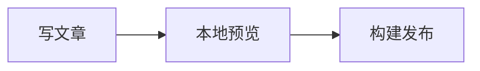

# 高级与可选功能配置

本文补全[参数字典](configuration-reference.md)中的可选功能。它们保留了主题实现，但多数默认关闭或缺少自己的服务／素材。这里说明怎样接入，不代表当前网站已经启用。每次只开一项，保存、重启开发服务器、检查浏览器与构建，再发布；不要把模板中的演示域名当作自己的服务。

## 访客设置面板 displaySettingsConfig.ts

它控制访客能调整哪些个人偏好，和作者工作台不是同一个东西。当前只开放主题色相和文章列表。`enable: false` 会关闭入口和所有子控件；`PUBLIC_DISPLAY_SETTINGS` 优先覆盖enable，但不自动开启各子项。访客设置留在自己的浏览器，不写作者JSON。

| 字段 | 类型 | 改成true后的作用 |
| --- | --- | --- |
| `enable` | boolean | 面板总开关 |
| `themeColorSwitchable` | boolean | 主题色选择器 |
| `layoutSwitchable` | boolean | 文章列表／网格 |
| `cardBorderSwitchable` | boolean | 卡片边框和阴影 |
| `cardFollowThemeSwitchable` | boolean | 卡片底色跟随主题色 |
| `wallpaperModeSwitchable` | boolean | 访客切换壁纸模式 |
| `fullscreenLayoutSwitchable` | boolean | 全屏classic／hero布局 |
| `wavesSwitchable` | boolean | 水波纹 |
| `gradientSwitchable` | boolean | 大图底部渐变 |
| `bannerTitleSwitchable` | boolean | 首页标题显示，仍需homeText.enable |
| `bannerCarouselSwitchable` | boolean | 壁纸轮换，仍需多图来源 |
| `overlaySwitchable` | boolean或对象 | true开放全部覆盖参数；false全关；对象分项控制 |
| `overlaySwitchable.opacity` | boolean | 图片不透明度滑块 |
| `overlaySwitchable.blur` | boolean | 背景模糊滑块 |
| `overlaySwitchable.cardOpacity` | boolean | 正文卡片不透明度滑块 |
| `sakuraSwitchable` | boolean | 樱花特效 |

例如只开放模糊、不让改透明度，用 `overlaySwitchable: { opacity: false, blur: true, cardOpacity: false }`。开启新的访客控件后，分别验证它与作者默认配置、轮换及手机显示的组合；默认关闭的控件不作为工作台替代品。

## 评论 commentConfig.ts

先部署／注册自己选用的评论服务，再把 `type` 从 `none` 改为 `twikoo`／`waline`／`artalk`／`giscus`／`disqus` 之一。只加载所选服务；其余配置可保留但不会同时启用。文章还可用frontmatter `comment: false` 单独关闭；密码文章默认不显示评论。友链／动态／打赏等页面有各自评论开关，留言板还需pages.guestbook。

| 服务／字段 | 类型／可选值 | 用途与具体填写 |
| --- | --- | --- |
| `type` | 上述枚举 | none完全关闭，不要填服务网址 |
| `twikoo.envId` | 字符串 | 自己的Twikoo环境ID或后端URL，替换演示地址 |
| `twikoo.region` | 可选字符串 | 传给Twikoo的部署区域；使用需要此字段的云环境时按服务区域填写 |
| `twikoo.lang` | 语言字符串 | 如zh-CN |
| `twikoo.visitorCount` | boolean | 使用服务文章访问计数 |
| `twikoo.jsUrl` | JS URL | 客户端SDK，需可访问并与服务兼容 |
| `twikoo.cssUrl` | CSS路径／空 | 自定义样式，文件存在才填写；空不加载 |
| `waline.serverURL` | HTTPS URL | 自己的Waline后端 |
| `waline.lang` | 字符串 | 如zh-CN |
| `waline.emoji` | URL数组 | 表情包地址；不用时[] |
| `waline.login` | enable／force／disable | 允许匿名和OAuth／强制登录／仅匿名 |
| `waline.visitorCount` | boolean | Waline访问计数 |
| `artalk.server` | HTTPS URL | 自己的Artalk API |
| `artalk.locale` | auto或语言 | en／zh-CN／zh-TW／ja／ko／fr／ru等 |
| `artalk.visitorCount` | boolean | Artalk访问计数 |
| `giscus.repo` | owner/repo | 安装Giscus的公开仓库，开启Discussions |
| `giscus.repoId` | 字符串 | Giscus设置生成的仓库ID，不是仓库名 |
| `giscus.category` | 字符串 | Discussions分类名 |
| `giscus.categoryId` | 字符串 | 该分类ID，与category配套 |
| `giscus.mapping` | 服务支持字符串 | 如title／pathname／url／number／specific等；选择后别随意换，否则旧评论匹配会变化 |
| `giscus.strict` | `"0"`／`"1"`字符串 | 宽松／严格匹配 |
| `giscus.reactionsEnabled` | `"0"`／`"1"` | 是否支持反应 |
| `giscus.emitMetadata` | `"0"`／`"1"` | 是否发送评论元数据 |
| `giscus.inputPosition` | top／bottom字符串 | 评论输入框位置 |
| `giscus.lang` | 语言字符串 | 如zh-CN |
| `giscus.loading` | lazy／eager | 懒加载／立即加载 |
| `disqus.shortname` | 字符串 | Disqus站点shortname，不是邮箱或完整网址 |

Giscus的repoId／categoryId等应从自己实例的生成配置复制，不猜数字。评论服务要放行正式域名与localhost开发域名；404、CORS、登录回调问题应在服务端设置处理。评论SDK、后端及CSS可能被网络阻断，配置正确也需要在目标访问环境验证。更换服务一般不会自动迁移历史评论。

## 统计 analyticsConfig.ts

空ID不加载对应统计服务。只填写自己实际使用的ID；不需要录屏就不要启用回放。配置和脚本地址会发布到浏览器。

| 字段 | 类型／单位 | 作用与修改例子 |
| --- | --- | --- |
| `googleAnalyticsId` | 字符串 | GA测量ID，如G-XXXXXXXXXX；空关闭 |
| `microsoftClarityId` | 字符串 | Clarity项目ID；空关闭 |
| `umamiAnalytics.websiteId` | 字符串 | Umami站点ID；空不加载 |
| `umamiAnalytics.scriptUrl` | HTTPS JS URL | 官方或自己的统计脚本 |
| `umamiAnalytics.replaysScriptUrl` | HTTPS JS URL | 会话回放脚本，和主脚本不同 |
| `umamiAnalytics.trackOutboundLinks` | boolean | 记录出站链接点击 |
| `umamiAnalytics.collectWebVitals` | boolean | 收集性能指标 |
| `umamiAnalytics.replays.enabled` | boolean | 回放总开关，默认false |
| `umamiAnalytics.replays.sampleRate` | 0–1数字 | 如0.15记录约15%会话 |
| `umamiAnalytics.replays.maskLevel` | moderate／strict | 遮罩输入／额外遮罩全部文本 |
| `umamiAnalytics.replays.maxDuration` | 毫秒 | 单次最大时长，300000为5分钟 |
| `umamiAnalytics.replays.blockSelector` | CSS选择器字符串 | 排除区域，如`.private-note`；空无额外选择器 |
| `la51Analytics.Id` | 字符串 | 51la ID，注意大写I；空关闭 |
| `la51Analytics.sdkUrl` | JS URL／空 | 自建SDK或空用默认 |
| `la51Analytics.ck` | 字符串／空 | 数据分离标识；空用Id |
| `la51Analytics.autoTrack` | boolean | 事件分析 |
| `la51Analytics.hashMode` | boolean | 本项目History导航通常false |
| `la51Analytics.screenRecord` | boolean | 51la录屏开关；默认配置中存在true，但ID空时不加载服务 |

侧栏stats是内容统计，不依赖这些服务；访问量卡片可能取评论服务计数，不应把文章数量当成真实访问人数。配置统计后检查页面只加载预期脚本，并按实际服务范围编写自己的隐私说明。

## 封面 coverImageConfig.ts 与许可 licenseConfig.ts

| 文件／字段 | 类型／值 | 作用 |
| --- | --- | --- |
| `coverImageConfig.enableInPost` | boolean | 文章详情页显示封面 |
| `.enableInPostOverlay` | boolean | 标题和元信息叠在封面上 |
| `.showLoading` | boolean | 转圈加载效果替代低清占位图 |
| `.randomCoverImage.enable` | boolean | 随机封面开关，默认false |
| `.randomCoverImage.apis` | URL数组 | 随机图片接口，按顺序尝试；返回内容要符合加载器预期 |
| `licenseConfig.enable` | boolean | 文章许可信息总开关 |
| `.name` | 字符串 | 例如CC BY-NC-SA 4.0；不是网站代码MIT协议的替代 |
| `.url` | HTTPS URL | 对应许可正文地址 |
| `.icon` | 图标名／空 | 空按名称匹配CC／CC0／Public Domain／开源许可等默认图标 |

想启用随机封面：先开启randomCoverImage.enable并检查API能直达图，再将目标文章image写成 `"api"`。显式图片不会因此都变成随机图。失败时会保留占位并提示，不会生成不存在的封面。单篇licenseName／licenseUrl可覆盖全站许可；确认自己拥有给内容授权的权利。

## 代码块、提醒框与图表

这些由Astro构建插件读取，修改后**重启开发服务器并重新构建**。

### expressiveCodeConfig.ts

| 字段 | 类型／示例 | 作用 |
| --- | --- | --- |
| `darkTheme` | 主题名，如one-dark-pro | 深色代码主题 |
| `lightTheme` | 主题名，如one-light | 浅色代码主题 |
| `theme` | 旧字段 | 已由lightTheme／darkTheme取代，不用它改当前主题 |
| `pluginCollapsible.enable` | boolean | 长代码折叠 |
| `.lineThreshold` | 正整数，默认15 | 超过多少行出现折叠 |
| `.previewLines` | 正整数，默认8 | 折叠时保留行数，应小于阈值 |
| `.defaultCollapsed` | boolean | 默认折叠长代码 |
| `pluginLanguageBadge.enable` | boolean | 右上角语言名称徽章 |
| `pluginLanguageLogo.enable` | boolean | 语言Logo，默认false |
| `.color` | mono／original／theme／HEX | 自动单色／品牌色／代码前景色／自选色 |
| `.excludedLangs` | 字符串数组 | 不显示Logo的语言，如["text", "plaintext"] |

主题名需由当前Expressive Code支持，填任意颜色名不是主题。普通语法示例：在三个反引号后写 `ts title="example.ts"`，正文写代码，再用三个反引号结束。长代码的阈值和折叠预览是全站规则，不改变代码文件本身。

### Mermaid：mermaidConfig.ts

| 字段 | 值 | 作用 |
| --- | --- | --- |
| `lightTheme` | editor-light／gruvbox-light／ayu-light等当前merman预设 | 明亮模式SVG主题 |
| `darkTheme` | editor-dark／one-dark／gruvbox-dark／ayu-dark等 | 深色模式SVG主题 |

文章使用：

````markdown

````

本项目用merman在构建时生成双主题SVG，并非完整浏览器Mermaid运行时；语法支持以当前渲染器为准。遇到不支持的语法先简化图，不要以为换主题能解决解析错误。

### PlantUML：plantumlConfig.ts

| 字段 | 类型／值 | 作用 |
| --- | --- | --- |
| `enable` | boolean | true渲染plantuml代码块，false退回普通代码 |
| `server` | HTTPS URL | 兼容PlantUML服务地址；公共默认值可替换为自建实例 |
| `lightTheme` | 主题名／空 | 亮色注入主题，空使用默认 |
| `darkTheme` | 主题名／空 | 深色主题，当前cyborg |

文章使用plantuml代码块，内容如 `@startuml`、`Alice -> Bob: Hello`、`@enduml`。渲染图片会请求配置服务器，图源会编码到请求中；私密设计不要发给公共服务，改用自己控制的服务。显式写入的主题与自动注入主题要检查是否冲突。

## 字体 fontConfig.ts

默认 `enable: false`、fontsList空数组、selected含system，使用系统字体，无需外部字体服务。开启步骤：准备允许分发的woff2 → 加入fontsList → 用它的cssVariable选择 → enable true → 重启并构建。

本地字体例子（文件为public/assets/fonts/my-font.woff2）：

```ts
export const fontsList: FontDefinition[] = [{
  name: "My Font", cssVariable: "--font-my", provider: "local",
  options: { variants: [{ src: ["./public/assets/fonts/my-font.woff2"], weight: "400", style: "normal" }] },
  fallbacks: ["sans-serif"], display: "swap",
}];
export const fontConfig: FontSelectionConfig = {
  enable: true, selected: ["--font-my", "system"],
  bannerTitleFont: "", bannerSubtitleFont: "", navbarTitleFont: "", codeFont: "",
  subsetFonts: {},
};
```

| 选择配置字段 | 类型 | 用途 |
| --- | --- | --- |
| `enable` | boolean | 字体功能总开关 |
| `selected` | 字符串或数组 | cssVariable名称，按顺序回退；system表示系统字体，不写字体文件名 |
| `bannerTitleFont` | cssVariable／空 | 大图主标题专用，空继承全局 |
| `bannerSubtitleFont` | cssVariable／空 | 大图副标题 |
| `navbarTitleFont` | cssVariable／空 | 导航标题 |
| `codeFont` | cssVariable／空 | 行内／代码块等宽字体，空用系统等宽栈 |
| `subsetFonts` | 变量名到对象的映射 | 本地字体子集化脚本配置，不是默认build自动执行 |
| `subsetFonts["--font-my"].extraChars` | 字符串 | 额外保留字符，覆盖动态内容会出现的字 |

| fontsList每项字段 | 类型／值 | 用途 |
| --- | --- | --- |
| `name` | 字符串 | 字体家族名称 |
| `cssVariable` | `--font-xxx` | 必须唯一，供selected等引用 |
| `provider` | google／fontsource／local／bunny／fontshare／npm或自定义对象 | 选择Astro字体提供者；远程提供者构建时可能需要网络 |
| `weights` | 字符串／数字数组 | 需要的字重，如[400,700]或可变范围，按字体实际支持 |
| `styles` | normal／italic／oblique数组 | 字体样式 |
| `subsets` | 字符串数组 | 提供者支持的字符子集 |
| `fallbacks` | 字体名数组 | 加载失败或缺字时回退 |
| `display` | auto／optional／fallback／block／swap | 浏览器字体加载显示策略 |
| `options.variants` | 本地变体数组 | 指定本地文件与字重样式 |
| `variants[].src` | 字符串数组 | 本地字体源码文件路径 |
| `variants[].weight` | 字符串／数字 | 该变体字重 |
| `variants[].style` | 字符串 | normal／italic等 |

自定义provider对象需实现Astro对应接口，name标识提供者，config为可序列化配置；options的其他字段取决于provider，不是本项目任意自造参数。当前只加载selected或区域字段实际引用的字体。高级子集脚本在 `scripts/subset-fonts.ts`，需先build再单独执行 `pnpm exec tsx scripts/subset-fonts.ts`，验证输出再部署；默认npm build未串接该步骤。中文子集遗漏字会回退，评论等动态文字应准备extraChars或使用覆盖完整的字体。

## 樱花 effectsConfig.ts

导出sakuraConfig，默认enable false。先开enable，再逐步调数量和速度；手机检查性能，系统减少动态效果也应尊重。

| 字段 | 类型／单位 | 作用与例子 |
| --- | --- | --- |
| `enable` | boolean | 总开关 |
| `sakuraNum` | 正整数 | 粒子数量，当前21，越多开销越大 |
| `limitTimes` | 整数 | 越界循环次数，-1无限 |
| `size.min`／`max` | 正数倍数 | 最小／最大尺寸，min不大于max |
| `opacity.min`／`max` | 0–1 | 透明度范围 |
| `speed.horizontal.min`／`max` | 动画内部速度数值 | 横向，负数偏左、正数偏右 |
| `speed.vertical.min`／`max` | 动画内部速度数值 | 下落速度，数值越大越快 |
| `speed.rotation` | 动画旋转步长 | 如0.03，过大转得快 |
| `speed.fadeSpeed` | 动画透明变化步长 | 如0.03，不应大于最小不透明度 |
| `zIndex` | 整数 | 绘制层级，如100；过高可能影响其他视觉层 |

速度不是毫秒或px/s的稳定物理单位，按实际动画逐项试调，不要把interval毫秒直接填进来。

## 看板娘 pioConfig.ts

Spine与Live2D各自enable false。仓库不承诺包含默认样例路径的全部模型；先取得允许分发的完整模型、纹理、动作文件，按目录相对引用放好，确认网络200，再开启。只改一个JSON路径不等于安装模型。

### spineModelConfig

| 字段 | 类型／值 | 用途 |
| --- | --- | --- |
| `enable` | boolean | Spine总开关 |
| `model.path` | 模型JSON URL | 根路径／HTTPS，依赖纹理等要一起提供 |
| `model.scale` | 正数倍数 | 模型缩放，1原比例 |
| `model.x`／`y` | 数值 | 模型内部偏移，按渲染效果试调 |
| `position.corner` | bottom-left／bottom-right／top-left／top-right | 屏幕锚点 |
| `position.offsetX`／`offsetY` | px | 距边缘偏移 |
| `size.width`／`height` | px | 容器尺寸，检查不要遮按钮 |
| `interactive.enabled` | boolean | 点击／待机交互 |
| `interactive.clickAnimations` | 动作名数组 | 必须是模型已有动作 |
| `interactive.clickMessages` | 字符串数组 | 点击随机提示 |
| `interactive.messageDisplayTime` | 毫秒 | 提示停留，3000为3秒 |
| `interactive.idleAnimations` | 动作名数组 | 待机随机动作 |
| `interactive.idleInterval` | 毫秒 | 待机切换间隔 |
| `responsive.hideOnMobile` | boolean | 手机隐藏 |
| `responsive.mobileBreakpoint` | px | 断点，如768 |
| `zIndex` | 整数 | 层级，当前1000 |
| `opacity` | 0–1 | 模型不透明度 |

### live2dWidgetConfig

| 字段 | 类型／值 | 用途 |
| --- | --- | --- |
| `enable` | boolean | Live2D总开关 |
| `model` | 单对象／对象数组 | 多项支持切模型 |
| `model[].path` | 模型JSON URL | 本地／外部模型路径 |
| `.volume` | 0–1 | 动作声音，0静音 |
| `.scale` | 正数倍数 | 缩放 |
| `.x`／`.y` | -2–2 | 正x向右，正y向上 |
| `position` | bottom-left／bottom-right | 页面位置 |
| `size` | px数字或{width,height} | 画布尺寸 |
| `primaryColor` | CSS颜色 | 菜单、状态UI色，可用已定义变量 |
| `transitionDuration` | 毫秒 | 入退场动画时长 |
| `transitionType` | slide／fade | 动画类型 |
| `menus.items` | 菜单数组 | 完全替代默认菜单 |
| `menus.extraItems` | 菜单数组 | 追加默认菜单 |
| `menus.*[].icon` | 可选图标名 | 菜单图标 |
| `.label` | 字符串 | 菜单文字 |
| `.action` | 已映射动作字符串 | home／scrollToTop／sleep／switchModel／github |
| `menus.align` | left／right | 菜单对齐 |
| `tips.enable` | boolean | 气泡开关 |
| `tips.welcomeMessage` | 字符串数组 | 欢迎语 |
| `tips.messages` | 字符串数组 | 循环提示 |
| `tips.duration` | 毫秒 | 每条展示时长 |
| `tips.interval` | 毫秒 | 提示间隔 |
| `tips.offset.x`／`y` | px | 气泡偏移，正x右、正y下 |
| `tips.typing.param` | 字符串 | 模型嘴型参数名，要与模型一致 |
| `tips.typing.speed` | 毫秒／字 | 打字速度 |
| `tips.typing.minValue`／`maxValue` | 0–1 | 嘴型开合范围 |
| `responsive.hideOnMobile` | boolean | 手机隐藏 |
| `responsive.mobileBreakpoint` | px | 手机断点 |

动作字符串不是任意JS或任意URL；未映射名字不会实现新动作。当前home／github动作在 `src/components/features/Live2DWidget.astro` 的menuActions中，继承了主题地址；启用前把home改成适配base的地址、github改自己的链接，或者从菜单移除它们。不要把未启用的演示动作当成已定制入口。

## 动态 dynamicConfig.ts

默认pages.dynamic false。启用文件动态：开页→在src/content/dynamic创建md→检查apiUrl与评论→加导航。可用 `npm run new-dynamic -- "今天的记录"` 生成时间戳文件（别在引号内容中放私密资料）。

| 字段 | 类型／值 | 用途 |
| --- | --- | --- |
| `title`／`description` | 字符串／空 | 页面标题与说明，空用i18n |
| `profileUrl` | 站内／HTTPS | 名称头像点击目标 |
| `showComment` | boolean | 每条动态评论，还需全站评论 |
| `itemsPerPage` | 正整数 | 每页数量，如20 |
| `apiUrl` | JSON URL | 默认/api/dynamic.json；第三方需同数据结构和CORS |
| `memos.enable` | boolean | true从Memos实时请求，忽略apiUrl |
| `memos.apiUrl` | 实例origin | 如https://memos.example.com，不是单条memo网址 |
| `memos.parent` | 字符串 | creator过滤，如users/example，区分大小写且与返回值完全一致 |

本地动态frontmatter：published必填日期／时间（YAML日期类型），pinned boolean默认false，location字符串默认空；其余正文是Markdown。Memos必须配置跨域并公开相应动态；不会读取私密账号凭证。文件模式与Memos是两种来源，不会自动合并。

## 书签导航 booknavConfig.ts

默认pages.booknav false；要启用，先移除／替换示例条目与失效图标，再开页加导航。每个分组和书签都可enabled false隐藏；权重越大越靠前，省略按0。

| 字段 | 类型 | 用途 |
| --- | --- | --- |
| `booknavPageConfig.title`／`description` | 字符串／空 | 页标题说明 |
| `.favicon.enabled` | boolean | 条目没icon时自动获取网站图标 |
| `.favicon.api` | URL模板 | 必须含{domain}，替换为目标域名 |
| `booknavConfig[].id` | 唯一字符串 | 分组锚点ID |
| `.name` | 字符串 | 分组名称 |
| `.icon` | 图标名 | 分组图标 |
| `.desc` | 字符串 | 分组说明 |
| `.weight` | 数字 | 分组排序权重 |
| `.enabled` | boolean | 分组显隐，省略true |
| `.items` | 数组 | 分组内书签 |
| `items[].title` | 字符串 | 网站名 |
| `.url` | HTTPS URL | 访问地址 |
| `.desc` | 字符串 | 简介 |
| `.icon` | 图标名／public路径／HTTPS | 空时按favicon规则获取 |
| `.weight` | 数字 | 组内排序 |
| `.enabled` | boolean | 条目显隐，省略true |

图标服务会知道请求的目标域名；不希望依赖外站时关闭favicon.enabled并给条目提供本地图标。

## 其他媒体列表 siteConfig.ts

以下页面与本项目B站快照逻辑独立，不使用external-sources.json，不共享其失败回退保证。当前默认关闭、账号空；需要自己的公开账号和可用API。

| 对象／字段 | 类型／值 | 用途与启用注意 |
| --- | --- | --- |
| `bangumi.userId` | 字符串 | Bangumi用户ID／用户名；开pages.bangumi并加导航 |
| `.mode` | static／dynamic | 构建取数／浏览器实时取数，后者需要CORS |
| `.apiUrl` | HTTPS API | 兼容Bangumi接口的服务origin，不是个人主页 |
| `.subjectBaseUrl` | URL末尾/ | 条目详情目标前缀 |
| `.categoryOrder` | anime／book／music／game／real数组 | 分类显示优先顺序；未列项按默认追加 |
| `.categories.book`／`anime`／`music`／`game`／`real` | boolean | 分类开关；real默认不启用，启用前验证服务及条目兼容 |
| `.nsfw` | off／blur／hide | 不过滤／模糊封面／隐藏条目 |
| `vndb.userId` | 字符串 | 如u123，开pages.vndb |
| `.mode` | static／dynamic | 构建／浏览器请求 |
| `.downloadCovers` | boolean | 当前路由会优先使用public/vndb-covers下已存在的压缩图；不代表默认build会自动下载 |
| `.apiUrl` | HTTPS URL | VNDB Kana兼容API |
| `.vnBaseUrl` | URL末尾/ | 条目目标，如https://vndb.org/ |
| `.apiToken` | 字符串 | 类型保留的私密列表令牌，仅static逻辑使用；不能把真实token提交到公开配置，公开列表无需填写 |
| `.nsfw` | off／blur／hide | 内容处理 |
| `mal.username` | 字符串 | 公开MyAnimeList用户名，开pages.mal，路由/myanimelist/ |
| `.clientId` | 字符串 | 自己申请的MAL Client ID，不是Client Secret |
| `.apiUrl` | HTTPS URL | MAL API地址 |
| `.animeBaseUrl` | URL末尾/ | 动画详情前缀 |
| `.mangaBaseUrl` | URL末尾/ | 漫画详情前缀 |
| `.nsfw` | off／blur／hide | 内容处理 |

这些遗留页面在开发模式可能仅抓第一页，生产构建会抓更多；不要把dev少量结果误判为全部丢失。接口变动需按实际返回验证。VNDB封面生成工具 `scripts/generate-vndb-covers.ts` 不在默认build链中；如果要用，需要先阅读脚本、单独执行并确认生成资源与授权，或自己提供同名图片，不能仅把downloadCovers设true就宣称已经离线缓存。

## 打赏 sponsorConfig.ts

默认pages.sponsor false、methods与sponsors均空，文章按钮关闭。启用前填自己的真实收款资源、确认允许公开，再开页／加导航。不要保留他人的收款示例。

| 字段 | 类型 | 用途 |
| --- | --- | --- |
| `title`／`description`／`usage` | 字符串 | 标题、介绍、用途说明 |
| `showSponsorsList` | boolean | 展示打赏者名单 |
| `showComment` | boolean | 评论区，仍需全站服务 |
| `showButtonInPost` | boolean | 文章底部打赏入口，页面开关也要开启 |
| `methods` | 对象数组 | 可用收款方式 |
| `methods[].name` | 字符串 | 如“支持小站” |
| `.icon` | 可选图标名 | 方式图标 |
| `.qrCode` | 可选公共图片路径 | 如/assets/images/support.webp |
| `.link` | 可选HTTPS URL | 外部收款目标 |
| `.description` | 可选字符串 | 方式说明 |
| `.enabled` | boolean | 是否显示该方式 |
| `sponsors` | 对象数组 | 手动维护的名单，不是自动支付回调 |
| `sponsors[].name` | 字符串 | 经本人同意的公开名称或“匿名” |
| `.avatar` | 可选图片地址 | 头像 |
| `.amount` | 可选字符串 | 显示金额，格式由你决定 |
| `.date` | 可选ISO日期字符串 | 显示日期 |

## 侧栏扩展类型：尚未接入工作台的字段

这些在类型和主题组件中保留，但当前工作台不允许新增advertisement／dynamic ID。只有开发者在注册、校验、适配和预览中一起接入才可用，不能直接往layout写。

| 类型字段 | 含义 |
| --- | --- |
| `WidgetComponentConfig.customProps` | 组件自定义参数对象；实际效果由组件实现决定 |
| `specificConfig.dynamic.limit` | 最新动态展示数量，默认3 |
| `specificConfig.ad.title`／`content` | 广告／提示标题与文字 |
| `.ad.image.src`／`alt`／`link`／`external` | 图片地址、替代文字、点击目标、新窗口 |
| `.ad.link.text`／`url`／`external` | 按钮文字、目标、新窗口 |
| `.ad.padding.top`／`right`／`bottom`／`left`／`all` | CSS长度内边距，例如"12px" |
| `.ad.closable` | 是否可关闭 |
| `.ad.displayCount` | 显示次数限制，-1不限 |
| `.ad.expireDate` | ISO到期日期 |

这些扩展属于源码维护；普通内容作者只用已经列在工作台的九个组件即可。任何新功能开关若没有自己的数据／素材／服务，先保持关闭，比填写模板中未验证的演示地址更容易维护。
