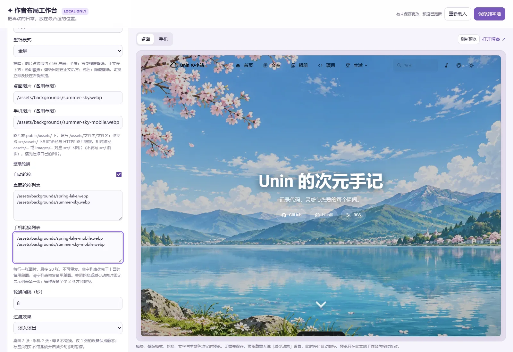
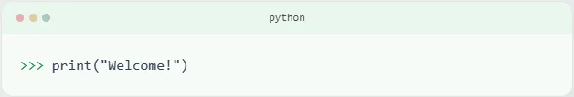
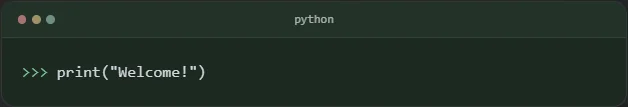

# 博客操作手册

这份手册按实际维护顺序说明操作。查某个字段的用途、类型、可选值、单位和示例，请打开[完整配置参数字典](configuration-reference.md)；评论、统计、字体、特效等可选功能见[高级配置](advanced-configuration.md)；发布原理见[架构与部署](architecture.md)。文中的姓名、UID、域名、文件名均为示例，请换成自己的值。

## 1. 第一次启动与日常使用

使用 Node.js 24、pnpm 11，在项目根目录打开终端。第一次运行或依赖变化后执行：

```sh
pnpm install --frozen-lockfile
```

| 想做什么 | 命令 | 地址／结果 |
| --- | --- | --- |
| 写文章、改文件、看开发效果 | `npm run dev` | 通常为 `http://localhost:4321/personal_web/`，以终端为准 |
| 拖拽调整首页、侧栏、壁纸和配色 | `npm run edit` | 工作台 `http://127.0.0.1:4321/__editor/`，博客本地根路径 `/` |
| 更新 GitHub／B站公开数据 | `npm run sync` | 更新 `src/data/external-snapshot.json`，不发布 |
| 检查配置与行为 | `npm run check`、`npm run lint`、`npm test` | 查看终端诊断 |
| 生成发布版本 | `npm run build` | 同步外部数据，生成 `dist/`、搜索索引，验证输出 |
| 查看真实生产效果 | 构建后 `npm run preview` | 通常为 `http://localhost:4321/personal_web/`，以终端为准 |
| 验证桌面、手机、作者工作台 | `npm run test:e2e` | 使用 4321、4322；测试结束恢复临时修改的布局 |

`dev`、`edit`、默认 `preview` 可能使用同一个 4321 端口。切换前在原终端按 `Ctrl+C` 停止服务，不要把另一个服务器的页面当成当前预览。浏览器测试前停止占用 4321、4322 的服务。Windows 使用 Edge 测试；其他系统先执行 `pnpm exec playwright install --with-deps chromium`。

Markdown、JSON、页面修改通常自动更新。改字体、代码高亮、提醒框、图表渲染、部署路径、环境变量等构建参数后，停止并重启服务器。`preview` 只读取上次构建结果，改源码后必须重新 `npm run build`。本地保存不会自动更新线上。

## 2. 文件、路径与配置优先级

| 位置 | 维护什么 |
| --- | --- |
| `src/content/posts/` | 文章 `.md`／`.mdx`、文章旁图片 |
| `src/content/projects/` | 项目正文、进度、排序、手写元信息 |
| `src/content/spec/about.md`、`friends.md` | 关于我、友链页附加说明 |
| `src/config/layout.json` | 工作台与手工编辑共用的首页、侧栏、视觉配置 |
| `src/config/*.ts` | 导航、资料、相册、音乐、其他可选功能 |
| `config/external-sources.json` | GitHub 仓库、B站 UID、个人观看进度 |
| `public/` | 原样发布的资源；`public/assets/a.webp` 的网址是 `/assets/a.webp` |
| `src/data/external-snapshot.json` | 同步脚本生成的公开快照，不是日常手工配置表 |

公共图片、音乐、站内链接写**不带仓库前缀**的根路径，例如 `/assets/music/song.mp3`。不要写 `public/assets/...`、磁盘盘符或重复 `/personal_web/`。构建会补部署前缀；作者模式使用 `/`。远程资源写完整 HTTPS 地址。文件名大小写必须完全一致，Linux 部署不像 Windows 容忍大小写混用。

JSON 用双引号、不允许注释和尾逗号；TypeScript 允许注释。修改数组时可复制现有项再改值，保持括号成对。修改前看清这些优先级：

1. `layout.json.visual.hue`、`pageWidth`、`postListMode` 覆盖 `siteConfig.ts` 的对应默认值；只改后者不会改变这些页面设置。
2. 壁纸模式、图片、轮换、首页大字、遮罩、正文卡片透明度、模糊取自 `layout.json.visual`；`backgroundWallpaper.ts` 负责映射并提供其他高级设置。
3. 侧栏位置、排序、显隐、吸附取自 `layout.json.sidebar`，由 `sidebarConfig.ts` 生成桌面／手机配置。
4. 本项目 B站 UID 取自 `config/external-sources.json`，不用 `siteConfig.ts.bilibili.uid`。
5. 访客已保存的主题、色相、文章列表等浏览器偏好可能继续优先。验证新默认值用无痕窗口，或清除本站 Local Storage 后刷新。
6. `PUBLIC_SITE_LANG`、`PUBLIC_PAGES_<页面大写键>`、`PUBLIC_DISPLAY_SETTINGS` 环境变量可覆盖相应配置，详见字典。

## 3. 作者布局工作台逐项操作

运行 `npm run edit`，进入 `/__editor/`。左侧修改草稿，右侧预览；检查桌面、手机和深浅主题后点**保存到本地**。保存仅写 `src/config/layout.json`。文章、项目正文、上传资源和音乐歌单仍由文件维护。

### 3.1 首页模块

拖动模块行改变顺序，或用 `↑`／`↓`；勾选控制显示。所有模块必须各出现一次，不要从 JSON 删除行，关闭显示即可。首页第一页之外只展示“最新文章”。

| 模块 ID | 显示内容 | 内容修改位置 |
| --- | --- | --- |
| `intro` 欢迎与介绍 | 欢迎句、介绍、关于页按钮 | `HomeDashboard.astro` 的 intro 分支，直接修改文案 |
| `featured` 精选文章 | 当前分页第一篇置顶文章；没有则第一篇文章 | 文章 `pinned`、`title`、`description` |
| `posts` 最新文章 | 文章列表与分页 | `src/content/posts/`；每页数量改 `pagination.postsPerPage` |
| `projects` GitHub 项目 | 按 order 降序取前三个非草稿 | `src/content/projects/` |
| `gallery` 相册速览 | 相册数组前两项 | `galleryConfig.ts.albums` 内容与顺序 |
| `anime` 追番记录 | 当前 UID 快照前四条 | 外部源配置与 `npm run sync` |
| `links` 友链入口 | 按权重取前四个启用友链 | `friendsConfig.ts` |

固定英文眉题、中文区块名、空态文案、截取数量在 `src/components/home/HomeDashboard.astro`；目前没有工作台文本框。要改这些位置，搜索该文字后编辑组件，不要向 JSON 添加未知字段。

### 3.2 侧栏、吸附和实色背景

**显示侧栏**为总开关，**桌面布局**选左／右／双侧。拖到另一栏，或使用行内左右选择器移动；栏内拖动／`↑↓` 排序。显示勾选控制启用，吸附勾选对应 `sticky`，开启后滚动长页时组件组停留在视口；检查总高度避免遮住屏幕。

单侧布局不会自动搬运另一侧组件，需要把想显示的组件移动到当前一侧。手机将组件合并到页底；中等屏幕双侧布局默认优先左侧。布局不是改变内容本身。

| 组件 | 内容来源／注意 |
| --- | --- |
| 个人资料 `profile` | `profileConfig.ts` 的头像、名字、简介、联系方式 |
| 公告 `announcement` | `announcementConfig.ts` |
| 音乐 `music` | `musicConfig.ts`，还需 `showInSidebar: true` |
| 分类 `categories` | 从文章 category 汇总；当前折叠阈值 5 |
| 标签 `tags` | 从文章 tags 汇总；当前折叠阈值 10 |
| 目录 `sidebarToc` | 有正文目录的内容页才显示，首页看不到是正常情况 |
| 统计 `stats` | 文章数量、字数等站内内容统计，不等于网络访问人数 |
| 日历 `calendar` | 发布日期和年度文章热力图 |
| 站点信息 `siteInfo` | 运行／构建信息，开始日取 siteStartDate |

**卡片背景**可分别设置浅色、深色背景：点击取色器或填六位 HEX，如 `#ffffff`／`#1d2523`。不接受透明色、三位或八位 HEX。侧栏始终实色，左右侧栏和手机页底共用当前主题的颜色，不受正文卡片不透明度影响。改深色背景后，在预览博客切深色检查对比度。

### 3.3 壁纸四种模式与轮换

| 模式 | 看得到的区别 |
| --- | --- |
| `banner` 横幅 | 顶部有限高度的大图，文章接在后方；向下滚动离开横幅 |
| `fullscreen` 全屏 | 首页先展示一整屏大图、标题，再向下进入正文；本项目默认 hero 布局 |
| `overlay` 透明覆盖 | 固定整页背景，内容卡片覆盖其上，没有占满首屏的标题区 |
| `none` 纯色 | 不显示图片与大图标题，使用主题纯色；停止轮换，保留图片配置 |

切换模式会立即预览结构变化；想比较横幅和全屏，先在首页滚到顶部。纯色模式下调整图片、轮换和背景模糊不会产生壁纸效果。



| 控件 | 类型／范围 | 具体怎么用 |
| --- | --- | --- |
| 文章默认布局 | 列表／网格 | 新访客默认样式，已有浏览器偏好可能继续生效 |
| 桌面／手机图片 | 图片路径 | 单图兜底；public文件写 `/assets/...`、`/images/...`；src图片写 `assets/...`、`images/...`，不加src前缀；也支持HTTPS |
| 桌面／手机轮换列表 | 每行一个地址，最多各 20 张 | 非空列表优先于单图；清空列表才恢复单图；两种设备各自独立 |
| 自动轮换 | 开／关 | 当前设备至少两张不同图片才可见轮换；关闭时显示列表首图 |
| 轮换间隔 | 3–600 秒 | 工作台按秒输入，文件按毫秒保存，例如 5 秒→5000 |
| 轮换过渡 | fade／slide／kenburns | 淡入淡出／滑动／缓慢推拉 |
| 主标题／副标题 | 1–100／1–250 字 | 首页大图文字，不是 SEO 标题 |
| 主题色相 | 0–360 | 0 红、120 绿、180 青、240 蓝、300 紫；改链接、按钮强调色 |
| 遮罩暗度 | 0–1 | 越大壁纸越暗；横幅、全屏、覆盖模式在首页和内页共用，纯色模式不显示壁纸 |
| 页面宽度 | 60–120 rem | 1rem 通常约16px；手机仍受屏幕限制 |
| 正文卡片不透明度 | 0.30–1 | 1 实色，较小可见背景；侧栏另设实色 |
| 背景模糊 | 0–30 px | 0 清晰；overlay 背景与 fullscreen 下滑模糊使用它 |

例如把两张横图放到 `public/assets/backgrounds/desk-01.webp`、`desk-02.webp`，在桌面列表逐行填其 `/assets/backgrounds/...` 地址；手机列表填另备的两张竖图。开启轮换、设5秒，分别在桌面、手机预览等待两次切换。非空列表优先，修改下面的单图却没有变化时，先检查列表。

新增默认布局已经提供夏日天空与春日湖畔两组图片并开启轮换；旧布局缺少新字段时保持单图兼容，不会擅自开启。操作系统／浏览器启用“减少动态效果”时会暂停自动轮换；页面在后台时也暂停，恢复可见后恢复计时。这些情况下没有切换不代表图片列表无效。

文件示例（合并到现有 `visual`，保留其他必需字段）：

```json
{
  "desktopImages": ["/assets/backgrounds/desk-01.webp", "/assets/backgrounds/desk-02.webp"],
  "mobileImages": ["/assets/backgrounds/phone-01.webp", "/assets/backgrounds/phone-02.webp"],
  "carouselEnabled": true,
  "carouselInterval": 5000,
  "carouselEffect": "fade"
}
```

壁纸以铺满方式显示，宽高比不同会裁边；重要主体放中间，手机另备竖图。追番海报采用完整显示，与铺满壁纸的裁边策略不同。

### 3.4 预览、保存与冲突

**桌面／手机**让 iframe 使用真实 1280／390px 视口，再缩小放入面板；不是把同一桌面网页简单拉窄外壳。**刷新预览**重新载入预览，**打开博客**在新标签检查已保存网页；未保存草稿仅作用于工作台 iframe。

**保存到本地**后等待成功提示。**重新载入**读取磁盘并放弃当前草稿。关闭页面不会云端自动保存。若外部编辑器也改了 JSON，版本检查会拒绝覆盖：先记录草稿，再重新载入，在最新配置上重做。撤销未保存修改用重新载入；恢复过去已保存的值，从 Git 历史找回旧版 `layout.json` 内容后再加载。不要删除必需字段、模块或乱改 version。

## 4. 更换个人资料、导航和联系方式

1. `profileConfig.ts` 改 name、bio；头像放 `public/assets/images/avatar.webp`，avatar 填 `/assets/images/avatar.webp`。
2. links 添加联系方式：name 名称，icon 如 `fa7-brands:github`／`material-symbols:mail-outline`，url 用 HTTPS 或 `mailto:hello@example.com`，showName 为 true 显示文字。
3. `siteConfig.ts` 改 title、subtitle、description、keywords，以及 navbar.title、logo。浏览器标题、首页大字、侧栏姓名是不同位置，需要分别修改。
4. `navBarConfig.ts.links` 控制菜单顺序和分组；删菜单不等于关闭路由，关闭页面用 siteConfig 顶部 pages。
5. 大图标题下社交图标另在 `backgroundWallpaper.ts.common.homeText.links`，不会自动复制个人资料 links，两处都检查。
6. 自我介绍与联系正文改 `src/content/spec/about.md`；页脚额外文案改 `src/config/FooterConfig.html`（HTML）。
7. 公告改 `announcementConfig.ts` 的 title、content、link；`link.enable: false` 隐藏按钮，`closable: false` 隐藏关闭按钮。

个人资料的生效入口是 `profileConfig.ts`，不要另复制一个不同名字的文件后以为会自动切换。图标集、Logo、页面开关、许可等每个字段详见字典。公开的联系方式和素材需要先确认可以发布。

## 5. 文章、标签、图片、Markdown 与 LaTeX

在 `src/content/posts/first-note/index.md` 新建：

```markdown
---
title: 我的第一篇文章
published: 2026-10-16
description: 对内容的一两句具体说明。
tags: [日常, 技术]
category: 生活
image: ./photo.webp
draft: false
pinned: false
---

## 今天的记录


行内公式：$E=mc^2$。

$$
\sum_{k=1}^{n} k = \frac{n(n+1)}{2}
$$
```

把 photo.webp 放在同目录。路径参与网址，发布后尽量不改名；同 slug 不要同时放 md 与 mdx。普通文章用 `.md`；需要导入组件并写 JSX 风格内容用 `.mdx`，`<`、`{` 等按 MDX 规则转义。

published／updated 写**不加引号**的日期，因为集合要求日期类型；draft true 从生产站文章列表排除，开发模式可能仍可预览草稿，false 发布；pinned true 置顶。category 是单个字符串，tags 是数组，拼写和大小写保持一致，标签／分类页面自动生成。

常用语法：`**加粗**`、`*斜体*`、`~~删除线~~`、反引号行内代码、`[链接文字](https://example.com)`、`[关于页](/about/)`、`- 列表项`、`> 引用`。代码块用三个反引号加语言名（如 ts／python）；默认超过15行可折叠。表格用竖线分列，第二行写 `| --- | --- |`。

公式由 KaTeX 渲染数学 LaTeX；不是 TeX 论文编译器，不写 documentclass、begin document 或任意 usepackage；化学式支持 `\ce{H2O}`。正文相对图片写 `./photo.webp` 可由 Astro 处理；public 图片写 `/assets/...` 按原文件发布，要自行压缩。图片 URL 必须直达文件，不能填图片详情网页；替代文字写具体画面。

默认提醒框：

```markdown
> [!NOTE]
> 补充说明写在这里。
```

系列文章用相同 `series`，用 `seriesOrder: 1`、`2` 升序排列；author 覆盖全站作者，sourceLink 记录转载来源，licenseName／licenseUrl 覆盖单篇许可，comment false 关闭该篇评论。完整 frontmatter 见[文章字段字典](configuration-reference.md#文章头部frontmatter)。prevTitle／prevSlug／nextTitle／nextSlug 自动生成，不手填。

password 非空启用静态正文加密，passwordHint 提示。标题、摘要、封面和元数据仍可能公开，公开 GitHub 中的 Markdown 源码也可读取；不要用于存放隐私、凭证或需要权限的资料。相册加密同样不能阻止直接访问 public 图片 URL。

## 6. GitHub 项目及可选状态

先在 `config/external-sources.json.github.repositories` 加公开仓库 `"example-user/my-project"`，再新建 `src/content/projects/my-project.md`：

```markdown
---
title: 我的项目
published: 2026-10-16
repo: example-user/my-project
status: in-progress
order: 10
tags: [Astro, 开源]
draft: false
---

这里写项目目标、截图、使用说明和进展。
```

运行 `npm run sync`，在 `/projects/` 检查。仓库列表只同步元信息，不会自动把每个仓库都生成项目卡片。status 支持 in-progress（进行中）、completed（已完成）、interrupted（中断），省略或空字符串隐藏，不填中文 key。状态始终手写，不由归档或提交时间推断。

order 越大越靠前，首页前三个。非空手写 title／description／language 优先；明确填写 stars（包括0）优先，恢复自动 star 数需删除 stars 行；非空 link 数组整体覆盖自动 GitHub 链接。无仓库项目可省略 repo，手写介绍和链接。所有字段详见字典。

## 7. 相册与照片说明

1. 建目录 `public/gallery/my-trip/`，放 jpg／jpeg／png／webp／avif／gif。按文件名排序，建议 `01-beach.webp`、`02-clouds.webp`；不递归子目录。
2. 在 `galleryConfig.ts.albums` 新增：

```ts
{
  id: "my-trip", name: "海边一日",
  description: "散步时看到的风景。", date: "2026-10-16",
  location: "海边", tags: ["旅行", "风景"],
  photoDescriptions: {
    "01-beach.webp": "傍晚的海面与灯塔。",
    "02-clouds.webp": "树梢上方的白云。",
  },
},
```

id 和目录名相同、唯一，建议小写英文加连字符。首页取数组前两项，调整数组顺序更换首页相册。封面优先级：手写 cover → cover.* → 第一张；cover.* 也会出现在相册。手写 cover 用 `/gallery/my-trip/01-beach.webp` 或 HTTPS。

远程照片在目录 urls.txt 中每行一条直接图片 URL，# 开头注释；排在本地照片之后。photoDescriptions 键用准确文件名，远程图片用完整 URL，说明用于图片下文字、替代文字和灯箱标题。点击／Enter 放大，Escape 关闭。columnWidth 控制瀑布流最小列宽（px），不是原图尺寸。password 与 passwordHint 使用限制见文章章节与字典。

## 8. 友链、关于页和联系信息

`friendsConfig.ts` 的 friendsConfig 数组添加：

```ts
{
  title: "朋友的小站", imgurl: "https://example.com/avatar.webp",
  desc: "一句具体介绍。", siteurl: "https://example.com/",
  tags: ["技术", "生活"], weight: 10, enabled: true,
},
```

enabled false 隐藏，weight 越大越靠前。friendsPageConfig.randomizeSort true 时友链页随机并忽略权重，首页仍按权重取前四个。页面 title、description 可独立设置；showCustomContent 控制 `src/content/spec/friends.md`，showComment 仍需全站评论服务。默认示例位置不是已建立的友链关系，发布前替换或隐藏。

关于页改 `src/content/spec/about.md`，直接按 Markdown 写介绍与联系信息。侧栏与大图图标联系方式分别在 profileConfig 与 backgroundWallpaper 中，详见第4节。

关于页会把单独一段的 `print("Welcome!")`（可加粗或用行内代码包裹）显示成 Python 终端，在进入页面时从左到右输入一次；光标仅在输入过程中显示，输入完成后消失。终端背景、标题栏与文字随网站的亮色／暗色主题自动切换。要换文案，直接把该段改成例如 `**print("你好，欢迎来玩！")**`；需保留单行 `print("...")` 或 `print('...')` 形式。





页面没有这种段落时，会在第一个一级标题后显示默认欢迎终端；默认代码在 `src/components/common/TypingTerminal.astro` 与 `AboutIntroduction.astro` 的 `code` 默认值中设置。`TypingTerminal.astro` 的首次 `setTimeout` 为输入前等待时间（默认250毫秒），`typeNext` 内的 `setTimeout` 为字符间隔（默认85毫秒）；单位均为毫秒，修改后刷新开发预览或重新构建发布。

已在系统中开启“减少动态效果”时直接显示完整代码；读屏始终可读完整代码，切换页面会清理计时器，重新进入时再播放一次。

## 9. Bilibili 列表与个人观看进度

B站空间 `https://space.bilibili.com/123456789` 的数字是 UID。配置示例：

```json
{
  "github": { "repositories": ["example-user/my-project"] },
  "bilibili": {
    "uid": "123456789",
    "overrides": { "987654": { "watchedEpisodes": 3, "status": "watching" } }
  }
}
```

UID 是数字字符串。公开追番列表后 `npm run sync`，不用 Cookie 或登录态。在 `src/data/external-snapshot.json.bilibili.items` 按 title 找到番剧，复制 id 作为 overrides 的键（media_id，不是 season ID／BV号）。

watchedEpisodes 是自己的已看非负整数，不是番剧官方已更新集数；status 支持 planned 想看、watching 在看、completed 看完、on-hold 搁置、dropped 弃番。只需状态就只写 status；删除字段停止本地覆盖。overrides 只补充已同步条目，不会凭 ID 新建番剧。追番卡片点击前往B站，没有额外本地详情弹窗。

留空 UID 关闭来源，换 UID 不沿用旧账号列表。关独立页面用 pages.bilibili，首页模块另在工作台隐藏。fresh 最近成功；stale 本次失败保留同来源旧数据；unavailable 无成功数据；unconfigured 未配置。成功空列表会替换旧数据。首次失败不伪造内容；排查 UID、公开设置、接口限制和网络。访客看静态快照，sync 后还需 build／发布，页面显示最后成功同步时间。

## 10. 本地音乐与 Meting

在 `musicConfig.ts` 配置：showInNavbar 顶栏入口、showInSidebar 侧栏入口（也需启用 music 组件）、volume 0–1、playMode list／one／random（列表／单曲／随机）、showLyrics 歌词。访客已有音量等偏好可能保留。

### 本地音乐

把有分发权限的文件放 public/assets/music/：

```ts
mode: "local",
local: {
  playlist: [{
    name: "示例曲名", artist: "示例作者",
    url: "/assets/music/song.mp3",
    cover: "/assets/music/cover.webp",
    lrc: "/assets/music/song.lrc",
  }],
},
```

name／artist／url 必填，cover／lrc 可省略，按数组顺序播放。远程 HTTPS 源也需允许浏览器访问。LRC 用 UTF-8，内容如 `[00:12.00]第一句歌词`；也能直接写 `lrc: "[00:12.00]第一句\n[00:16.50]第二句"`。普通歌词网页不能代替歌词文件。

### Meting

```ts
mode: "meting",
meting: {
  api: "https://music.example.com/api?server=:server&type=:type&id=:id&auth=:auth&r=:r",
  server: "netease", type: "playlist", id: "1234567890", auth: "",
  fallbackApis: ["https://backup.example.com/api?server=:server&type=:type&id=:id"],
},
```

api 填返回歌曲数组的接口，不是歌单网页；server 平台、type 类型、id 对象ID必须与服务匹配。类型允许 netease／tencent／kugou／xiami／baidu；type 允许 song／playlist／album／search／artist，但实际支持看API。auth 只能填可公开客户端参数，没有就空，绝不能放服务端密钥或 Cookie。fallbackApis 按顺序备用，不需时 `[]`。

`:server`、`:type`、`:id`、`:auth` 自动替换并 URL 编码，`:r` 是防缓存随机值；不要写成 `{id}`。接口需兼容 Meting 歌曲数组，通常含 name／artist／url／pic／lrc。歌单、音频、图片和歌词跨域、版权、链接过期、HTTPS页面调用HTTP都可能失败。

刷新开发页，手动点播放检查声音、封面、歌词；不会强制初次自动播放。站内导航保持同一音频实例，整页刷新不保证连续。失败可重试；CORS 错误需修复服务端响应头或换允许公开访问的源，前端配置无法解除服务端限制。

## 11. 发布与排错

发布前执行 check、lint、test、build，在 preview 检查手机、深色、图片、搜索和音频。查看 git diff，只提交网站资源与维护文件，不提交凭证、私人资料、日志、缓存或本地助手状态。推送分支、验证后合入 main；仓库 Settings → Pages → Source 选 GitHub Actions。等待部署成功再访问 `/personal_web/`。每日北京时间06:00尝试更新外部数据，实际时间受排队影响；本地未推送文件不会被远端读取。更多见[发布说明](architecture.md)。

| 现象 | 排查方法 |
| --- | --- |
| 保存后线上没变 | 是否推送、合入main、部署完成；本地保存不发布 |
| 改 siteConfig 色相／宽度没用 | 改 layout.json 对应字段，那里优先 |
| 轮换没动 | 当前设备至少两图、开关开、间隔到、非none；检查减少动态效果和后台暂停 |
| 换单图仍是旧图 | 非空轮换列表优先，修改或清空列表 |
| 手机看起来同桌面 | 使用工作台390px预览，检查独立手机列表和图片是否同一文件 |
| 默认主题／列表没变 | 无痕窗口排除旧浏览器偏好，再查环境变量 |
| 图片本地有线上404 | 文件已提交，大小写正确，别带public／盘符／重复base |
| 搜索无结果或不可用 | 导航栏输入文章／项目标题、标签或正文关键词，按 Enter 可打开完整结果；手机先点放大镜。dev 和作者预览也支持真实搜索。追番页输入作品名会立即筛选，清空恢复全部。生产 Pagefind 加载失败会自动使用公开内容索引；若提示不可用，检查网络后点“重试”，并确认文章不是草稿或加密文章、最新改动已构建发布 |
| 追番旧数据 | 核对UID和最后成功时间，先sync再build／发布 |
| 页面开了没有菜单 | 自定义导航需自己加条目 |
| 页面关了首页仍有入口 | 路由开关和首页模块独立，隐藏相应模块与自定义链接 |
| 评论／看板娘不显示 | 看高级配置启用条件；默认关闭功能需要真实服务／模型，样例路径不代表资源已存在 |

需要排错时保留终端错误与浏览器 Network 失败 URL，不要把私密 Cookie、token 或私人配置贴到公开 issue。
